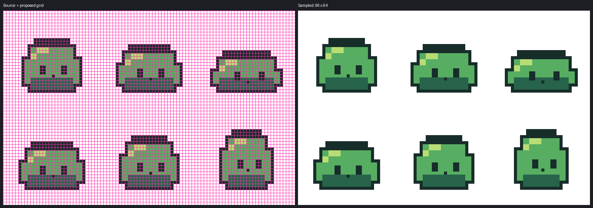

# Arty

A local CLI for producing pixel-art assets: generate or edit images through OpenAI,
recover native pixel grids, assemble registered layers and sprite sheets, and
verify and review immutable revisions. Optional stdio MCP tools work with Codex
and other MCP clients.

**Status: alpha.** Source images stay intact. Generation is explicit and can incur
API charges; processing and review run offline. Technical verification and human
artistic approval are separate gates. No engine-specific importer is included.

## Install and try it offline

Requires Git and Python 3.11+. These commands use Python's built-in virtual
environments and pip; no `uv` or API key is required.

```sh
git clone https://github.com/rancidone/arty.git
cd arty
python3 -m venv .venv
# macOS / Linux:
source .venv/bin/activate
# Windows PowerShell: .venv\Scripts\Activate.ps1
python -m pip install .
arty convert examples/slime-enlarged.png -o work/slime.png --size 96x64 --columns 3 --rows 2 --preview work/preview.png
```

On Windows, use `py -3` instead of `python3` to create the environment. If
PowerShell activation is disabled, invoke `.venv\Scripts\arty.exe` directly.
Open `work/preview.png`: the source appears with its proposed grid beside the
recovered 96×64 sheet. This deterministic fixture should reproduce
`examples/slime-original.png` exactly. Output paths must be new.



For automatic detection, omit `--size` and inspect the result. Irregular generated
art may require an explicit size or scale and visual review.

## Workflows and documentation

- [Usage and installation options](docs/usage.md): recovery, generation/editing,
  review decisions, configuration, limitations and troubleshooting.
- [Runnable offline examples](examples/README.md): layered build, atlas and fitting.
- [JSON spec reference](docs/specs.md): fields, defaults and pixel operations.
- [MCP server](docs/mcp.md): installation, trusted filesystem access and paid calls.
- [Contributing and release checks](CONTRIBUTING.md), [security reporting](SECURITY.md).

The `arty` and `arty-mcp` commands are preferred. Legacy `art-pipeline` and
`art-pipeline-mcp` commands remain available. The Python package is `art_pipeline`.

## License

Copyright (c) 2026 art-pipeline contributors. Arty's code, documentation, and
bundled demo assets are licensed under the [GNU GPL version 3 only](LICENSE)
(`GPL-3.0-only`). The bundled slime art is drawn programmatically by
[`scripts/make_demo.py`](scripts/make_demo.py).

## Windows

Use 64-bit Python 3.11–3.14 and PowerShell; administrator privileges and Developer
Mode are not required for normal use. See [Windows setup and verification](docs/windows.md).
Windows CI is configured; platform support should be judged from passing job
results. Windows ARM and network shares have not been validated.
